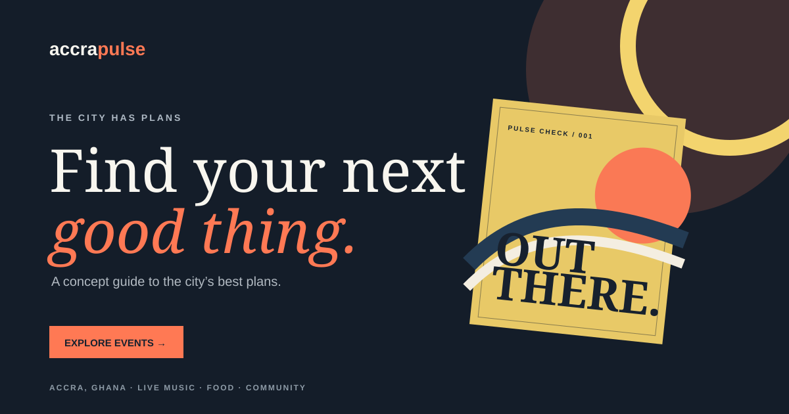

# AccraPulse

<p align="center">
  
</p>

<p align="center">
  A polished, responsive event-discovery concept for Accra, Ghana.
</p>

AccraPulse helps curious residents discover worthwhile plans without the noise: live music, creative meetups, food pop-ups, art, and community events. It is a front-end portfolio concept, built to make browsing feel quick, local, and inviting.

## Highlights

- Search events by title, category, venue, or neighbourhood.
- Filter the line-up by category and switch to a saved-events view.
- Open accessible event details with keyboard Escape and backdrop dismissal.
- Save and unsave events directly from a card or detail view.
- Use the responsive navigation and layouts comfortably on small screens.
- Subscribe to a client-side newsletter demo with clear confirmation feedback.
- Browse custom CSS poster artwork; the interface has no third-party image dependency.

## Built with

- [React 18](https://react.dev/)
- [Vite 5](https://vite.dev/)
- Modern CSS and inline SVG icons

## Getting started

### Requirements

- Node.js 18 or later (Node.js 20 LTS is recommended)
- npm 9 or later

### Install and run

```bash
npm install
npm run dev
```

Vite prints the local development URL in the terminal (normally `http://localhost:5173`).

On Windows systems where PowerShell blocks `npm.ps1`, use the command shim instead:

```powershell
npm.cmd install
npm.cmd run dev
```

### Production build

```bash
npm run build
npm run preview
```

The production-ready files are generated in `dist/`.

## Available scripts

| Command | Purpose |
| --- | --- |
| `npm run dev` | Starts the Vite development server with hot reload. |
| `npm run build` | Creates an optimized production build in `dist`. |
| `npm run preview` | Serves the most recent production build locally. |

## Project structure

```text
accra-pulse/
├── public/
│   ├── accra-pulse-preview.svg  # README preview image
│   └── favicon.svg
├── src/
│   ├── main.jsx                 # App components, sample data, interactions
│   └── styles.css               # Responsive visual system
├── index.html
└── package.json
```

## Deployment

This is a static Vite application and can be deployed to Netlify, Vercel, Cloudflare Pages, or GitHub Pages.

For Netlify:

1. Push `accra-pulse` to a Git repository.
2. Import the repository into Netlify.
3. Set the build command to `npm run build`.
4. Set the publish directory to `dist`.
5. Deploy.

## Content and production notes

All listings, dates, organisers, ticket prices, and descriptions in this repository are illustrative. Before publishing a live directory:

- Replace sample event data in [`src/main.jsx`](./src/main.jsx) with verified organiser data.
- Connect the newsletter to a consent-aware email service or secure backend endpoint; the current form stores and sends nothing.
- Replace the generic WhatsApp message link with approved organiser contact or ticketing URLs.
- Add event moderation, privacy, terms, accessibility review, analytics, and error monitoring.

## Visual assets

The README preview is a repository-native SVG at [`public/accra-pulse-preview.svg`](./public/accra-pulse-preview.svg). All poster artwork is rendered in CSS, so the project does not rely on remote stock images or external image hosts.

## License

This repository is provided as a portfolio demonstration. Contact the project owner before reusing its brand, copy, or design work.
